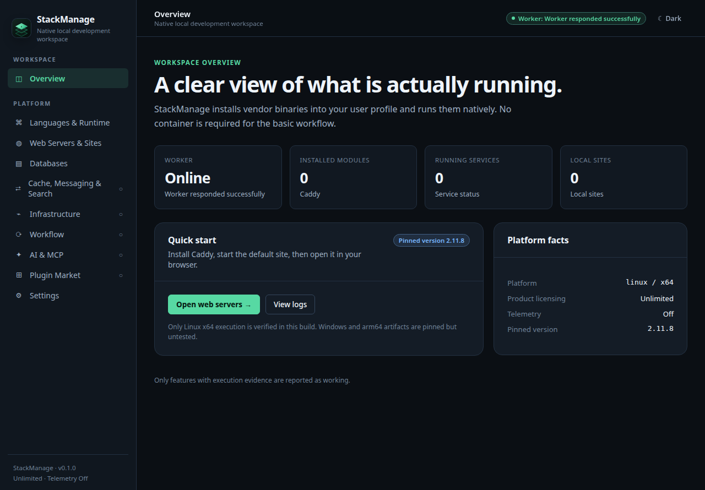
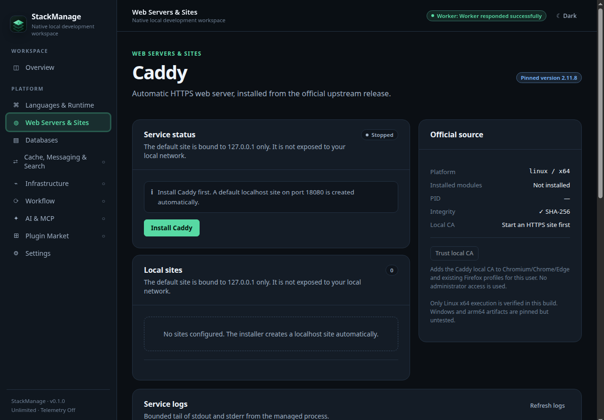

<div align="center">
  

  <h1>StackManage</h1>

  <p><strong>Run your local development stack natively.</strong></p>

  <p>
    StackManage is an independent desktop workspace for installing and running
    web servers, runtimes, databases and local sites on your own machine.
    No container is required for the core workflow.
  </p>

  <p>
    
    
    
    
  </p>

  <p>
    <a href="#install">Install</a> ·
    <a href="#interface-preview">Screenshots</a> ·
    <a href="#what-you-can-run">Features</a> ·
    <a href="#mcp-server">MCP</a> ·
    <a href="#build-from-source">Build from source</a> ·
    <a href="#documentation">Documentation</a>
  </p>
</div>

---

## Why StackManage?

- **Native by default.** Install vendor binaries into your user profile and run
  them directly. You do not need Docker, a VM or a background cloud account for
  everyday local development.
- **Pinned and verified downloads.** Each module resolves an official artifact,
  checks its SHA-256 digest and validates the result before it is used.
- **One workspace for the local stack.** Manage services, local domains and
  HTTPS beside the runtimes and databases that power them.
- **Loopback-first.** Managed sites and services bind to `127.0.0.1` by default
  and are not exposed to your network.
- **No telemetry and no licence gate.** StackManage has no usage reporting,
  activation key or artificial module/site/project limits.
- **Honest about limits.** Areas that are not implemented are labelled as
  unavailable instead of being simulated.

## What you can run

| Module | Pinned release | What StackManage can do today | Support |
|---|---|---|---|
| **Caddy** | 2.11.8 | Install from the official release, verify the checksum, start/stop/restart, serve HTTP and HTTPS sites on loopback, manage a marked hosts block for `.test` domains, trust the local CA in browser stores, show bounded logs | Linux x64 verified |
| **Node.js** | 24.22.2 | Install the official runtime per user, verify SHA-256, run `node --version`, expose the binary path and a PATH-prepend plan, uninstall | Linux x64 verified |
| **Nginx** | 1.30.6 | Build from official source into a per-user prefix, validate with `nginx -t`, serve on `127.0.0.1:18081`, reload, stop and uninstall | Linux x64 verified |
| **Redis** | 7.2.7 | Build from official source, run on `127.0.0.1:16379` with protected mode and a 64 MiB cap, check `PING`/`PONG`, use `SET`/`GET`, stop and uninstall | Linux x64 verified |
| **MCP server** | 1.32.2 SDK | Expose seven read-only tools over stdio for inspection of the local workspace | Linux x64 tested |
| **Plugin host** | 1.0.0 SDK | Install, verify, enable, disable and remove signed local plugin packages with an isolated child process | Linux x64 tested |
| **PHP build runner** | 8.5.12 | Reproducibly build and verify a Linux x64 PHP runtime tarball on a Docker/Podman-capable host | Build tooling only |

The desktop app currently includes **Overview**, **Languages & Runtime**,
**Web Servers & Sites**, **Databases** and **Settings**. Cache/messaging,
infrastructure, workflow automation, AI clients and the plugin marketplace are
shown as unavailable until their implementations and evidence land.

> **Platform note:** Linux x64 is the only platform with end-to-end execution
> evidence in this release. Linux arm64 uses the same pins but has not been
> executed. Windows and macOS are not supported yet. See the
> [support matrix](docs/feature-matrix.md) for the precise state of each feature.

## Interface preview

Screenshots from the Linux x64 build:

<table>
  <tr>
    <th width="50%">Overview</th>
    <th width="50%">Web Servers &amp; Sites</th>
  </tr>
  <tr>
    <td></td>
    <td></td>
  </tr>
</table>

The same shell also contains the Node.js runtime installer, the Redis database
card, theme and language settings, and clearly labelled unavailable areas for
features that are not implemented yet.

## How it works

StackManage has three layers:

1. **Desktop shell** — a sandboxed Electron window with context isolation and a
   narrow, typed preload bridge.
2. **Local worker** — a forked Node.js process that owns installations,
   service processes, PID checks, logs and persisted state.
3. **Module adapters** — per-module code that downloads an official artifact,
   verifies its digest and signature where available, installs into a managed
   per-user prefix, and starts or stops the service with validated
   configuration.

Nothing is installed system-wide. Actions are typed requests over IPC, not
shell strings. Services bind to loopback, and application state stays in the
current user's data directory.

## Install

### Requirements

| Requirement | Needed for | Notes |
|---|---|---|
| Linux x64 with a desktop session | Running the app | Linux x64 is the verified platform in this release |
| Electron system libraries | `.deb` and source builds | `apt` resolves the declared `.deb` dependencies |
| Node.js **24.x** | Source builds and development | The packaged app bundles its own Electron/Node runtime |
| pnpm **10.32.1** | Source builds and development | Declared in `packageManager` |
| C compiler, `make`, PCRE2, zlib, OpenSSL headers | Building Nginx | `sudo apt install build-essential pkg-config libpcre2-dev zlib1g-dev libssl-dev` |
| C compiler and `make` | Building Redis | Included in `build-essential` |
| `libnss3-tools` | Trusting the local CA in browsers | Provides `certutil` for Chrome/Chromium/Edge/Firefox profiles |

### Option A — Install the Linux x64 package (recommended)

1. Open the [GitHub Releases](https://github.com/elangb/stackmanage/releases)
   page and download `StackManage-0.1.0-amd64.deb`.
2. Optional: verify the download against the release checksum.

   ```sh
   cd ~/Downloads
   sha256sum StackManage-0.1.0-amd64.deb
   ```

3. Install the package. `apt` resolves the Electron libraries automatically.

   ```sh
   sudo apt install ./StackManage-0.1.0-amd64.deb
   ```

4. Launch **StackManage** from your application menu, or run the packaged binary
   directly:

   ```sh
   /opt/StackManage/stackmanage
   ```

5. Confirm that the **Worker** badge in the top-right corner says
   **Worker responded successfully**. If it does not, see
   [Troubleshooting](#troubleshooting).

### Option B — Run from source

1. Install Node.js 24.x and enable pnpm:

   ```sh
   node --version
   # v24.x.x required
   corepack enable
   corepack prepare pnpm@10.32.1 --activate
   pnpm --version
   ```

   If Node.js is not installed, use your distribution packages, NodeSource or
   `nvm`; the repository requires Node 24.

2. Install the desktop and native build dependencies on Debian/Ubuntu:

   ```sh
   sudo apt install \
     build-essential pkg-config libpcre2-dev zlib1g-dev libssl-dev libnss3-tools \
     libgtk-3-0 libnotify4 libnss3 libxss1 libxtst6 xdg-utils \
     libatspi2.0-0 libuuid1 libsecret-1-0
   ```

3. Clone the repository:

   ```sh
   git clone https://github.com/elangb/stackmanage.git
   cd stackmanage
   ```

4. Install the workspace:

   ```sh
   pnpm install --frozen-lockfile
   ```

5. Start the development app:

   ```sh
   pnpm dev
   ```

   Vite binds only `127.0.0.1:5179`. Changes to the main process, preload or
   worker require restarting `pnpm dev`.

6. On a headless Linux machine, use a desktop session or run the smoke test with
   a virtual display:

   ```sh
   xvfb-run -a pnpm test:desktop
   ```

### Option C — Build your own `.deb`

```sh
pnpm install --frozen-lockfile
pnpm build
pnpm dist:linux:deb:x64
sudo apt install ./release/StackManage-0.1.0-amd64.deb
```

The arm64 package can be built on a compatible host:

```sh
pnpm dist:linux:deb:arm64
```

If the package build fails with a temporary-directory quota error, point
`TMPDIR` at a directory with enough space:

```sh
mkdir -p ~/.cache/stackmanage-tmp
TMPDIR=~/.cache/stackmanage-tmp pnpm dist:linux:deb:x64
```

Artifacts are written to `release/`. Packaging details and current limits are in
[docs/packaging.md](docs/packaging.md).

### First-run walkthrough

1. **Open Overview.** Check that the worker badge is green and the platform
   line shows `linux / x64`.
2. **Install Caddy.** Open **Web Servers & Sites**, click **Install Caddy**, and
   wait for the checksum-verified download to finish. Click **Start**.
3. **Open the default site.** The default Caddy site is
   `http://localhost:18080` and is bound to loopback only.
4. **Enable HTTPS for a local site.** Add a site such as `myapp.test`, select an
   absolute document root and an unused port, enable **HTTPS**, apply the site
   and restart Caddy if prompted. Then click **Trust local CA** so
   Chrome/Chromium/Edge and existing Firefox profiles accept the certificate.
   A `.test` hostname also needs the managed hosts block; a `localhost` hostname
   does not.
5. **Install Node.js.** Open **Languages & Runtime**, click **Install Node.js**,
   and verify the reported version is `v24.22.2`. StackManage shows the binary
   path and a PATH-prepend plan; it does not modify your shell profile.
6. **Install Nginx.** In **Web Servers & Sites**, install and start Nginx. The
   build uses the official pinned source and serves `127.0.0.1:18081`. Use the
   log panel to inspect startup or reload failures.
7. **Install Redis.** Open **Databases**, install and start Redis. It listens on
   `127.0.0.1:16379` in protected mode with a 64 MiB cap. The card confirms the
   server with `PING`/`PONG` and exposes bounded logs.
8. **Adjust the workspace.** Open **Settings** to switch the theme or language.
   Five locales are available: English, Indonesian, Chinese, Spanish and
   Vietnamese.

### Update

Install the newer package over the existing one; your user data is preserved:

```sh
sudo apt install ./StackManage-<new-version>-amd64.deb
```

Stop running services before replacing the package if you want to avoid a
process owned by the previous installation.

### Uninstall

1. Stop any running Caddy, Nginx or Redis service from the app.
2. Remove the package:

   ```sh
   sudo apt remove stackmanage
   ```

3. Application data is stored in Electron's per-user data directory and is not
   removed by `apt remove`. Remove that directory manually if you want a clean
   reset.

### Troubleshooting

| Symptom | What to do |
|---|---|
| **Worker unavailable** | Restart the app. If it persists, start from a terminal to see startup errors, then check the worker log. |
| **Trust local CA** is unavailable | Install `libnss3-tools`; the trust action needs `certutil`. |
| Nginx or Redis installation stops at the build step | Install `build-essential`, `make`, `pkg-config`, `libpcre2-dev`, `zlib1g-dev` and `libssl-dev`, then retry. |
| Port already in use | Caddy uses `18080`, Nginx uses `18081` and Redis uses `16379`. Check with `ss -ltnp | grep -E '18080|18081|16379'` and stop the conflicting process. |
| Hosts warning for a `.test` domain | Use a `localhost` domain or grant the platform helper permission to update `/etc/hosts`. |
| The app does not open on a headless machine | Use a desktop session, or validate the packaged desktop shell with `xvfb-run -a pnpm test:desktop`. |
| `.deb` build fails with `Disk quota exceeded` | Use `TMPDIR=~/.cache/stackmanage-tmp pnpm dist:linux:deb:x64`. |
| MCP client cannot start the server | Build it first with `pnpm --filter @stackmanage/mcp-server build` and use the absolute path to `packages/mcp-server/dist/index.js`. |

## MCP server

StackManage ships a real stdio MCP server for **read-only** inspection. It opens
no TCP port and has no install, start, stop or write tool.

| Tool | Purpose |
|---|---|
| `system.info` | Host and runtime information |
| `modules.list` | Supported module catalog |
| `installations.list` | Recorded installations |
| `services.status` | Service identity and readiness |
| `sites.list` | Managed local sites |
| `logs.tail` | Bounded log tail with redaction |
| `config.read` | Bounded configuration read with redaction |

Build it first, then register the absolute path in your MCP client:

```sh
pnpm --filter @stackmanage/mcp-server build
```

```json
{
  "mcpServers": {
    "stackmanage": {
      "command": "node",
      "args": ["/absolute/path/to/stackmanage/packages/mcp-server/dist/index.js"]
    }
  }
}
```

See [docs/mcp.md](docs/mcp.md) for the data layout, redaction rules and security
model. Mutations are intentionally out of scope until an authenticated and
user-approved bridge exists.

## Plugins

The local plugin host verifies Ed25519-signed packages, pins package and
manifest digests, installs into a managed directory and runs one child process
per enabled plugin. It is a backend capability: the marketplace UI is not part
of this release. The child process is **not** an OS sandbox; see
[docs/plugin-sdk.md](docs/plugin-sdk.md) for the capability model and limits.

## PHP runtime builder

The PHP builder produces a verified `tar.gz`, SHA-256 and manifest without
requiring host root. It needs Docker or Podman:

```sh
./scripts/php/build-php-runtime.sh --output-dir release/php
./scripts/php/build-php-runtime.sh --verify-only --output-dir release/php
```

The desktop PHP module, PHP-FPM site integration and a PHP runtime installer are
not included in this release. Build details are in
[docs/php-build-runner.md](docs/php-build-runner.md).

## Build from source

Already covered in [Option B](#option-b--run-from-source) for normal development
and [Option C](#option-c--build-your-own-deb) for packaging. The full release
gate is:

```sh
pnpm check
xvfb-run -a pnpm test:desktop
```

Real-network module tests are opt-in because they download pinned upstream
artifacts:

```sh
STACKMANAGE_INTEGRATION=1 pnpm exec vitest run apps/worker/test/caddy.integration.test.ts
STACKMANAGE_INTEGRATION=1 pnpm exec vitest run apps/worker/test/node.integration.test.ts
STACKMANAGE_INTEGRATION=1 pnpm exec vitest run apps/worker/test/nginx.integration.test.ts
STACKMANAGE_INTEGRATION=1 pnpm exec vitest run apps/worker/test/redis.integration.test.ts
```

## Project layout

| Path | Responsibility |
|---|---|
| `apps/desktop` | Electron main process, sandboxed preload, Vue renderer and module controllers |
| `apps/worker` | Forked worker that owns module installation, processes and PID state |
| `packages/core` | Versioned IPC and operation contracts |
| `packages/platform` | OS adapter boundary for hosts, trust, autostart and shell plans |
| `packages/modules` | Module catalog declarations |
| `packages/mcp-server` | Read-only stdio MCP server |
| `packages/plugin-sdk` | Plugin manifest and JSON-RPC schemas |
| `packages/plugin-host` | Signed package installer, registry verification and plugin runtime |
| `packages/i18n`, `packages/ui` | Five locales and original design tokens |
| `build`, `ci`, `scripts` | Runtime builders, CI templates and verification scripts |

## Documentation

- [Feature and evidence matrix](docs/feature-matrix.md)
- [Architecture decision records](docs/adr/0001-foundation.md)
- [Contracts](docs/contracts-v1.md)
- [Platform adapters](docs/platform-adapters.md)
- [MCP server](docs/mcp.md)
- [Plugin SDK](docs/plugin-sdk.md)
- [PHP build runner](docs/php-build-runner.md)
- [Packaging](docs/packaging.md)
- [Legal analysis](docs/legal/license-analysis.md)
- [Third-party notices](THIRD_PARTY_NOTICES.md)

## Security

- The Electron renderer runs sandboxed with context isolation and a narrow,
  typed preload bridge.
- Services bind to loopback by default; StackManage does not add firewall rules
  or expose them publicly.
- Downloads use pinned HTTPS sources, allowlists, size limits, checksum checks
  and, where available, detached signatures.
- The local CA is trusted only in the current user's browser stores. System-wide
  trust is a separate, explicit elevation path.
- Secrets in logs and configuration are redacted before they leave the MCP
  server.

## Contributing

Issues and pull requests are welcome. Before opening a pull request, run
`pnpm check` and `xvfb-run -a pnpm test:desktop`, and keep documentation aligned
with the actual execution evidence.

## License

StackManage is released under the [BSD 3-Clause License](LICENSE). Third-party
components and downloaded vendor runtimes keep their own licences; see
[THIRD_PARTY_NOTICES.md](THIRD_PARTY_NOTICES.md).
